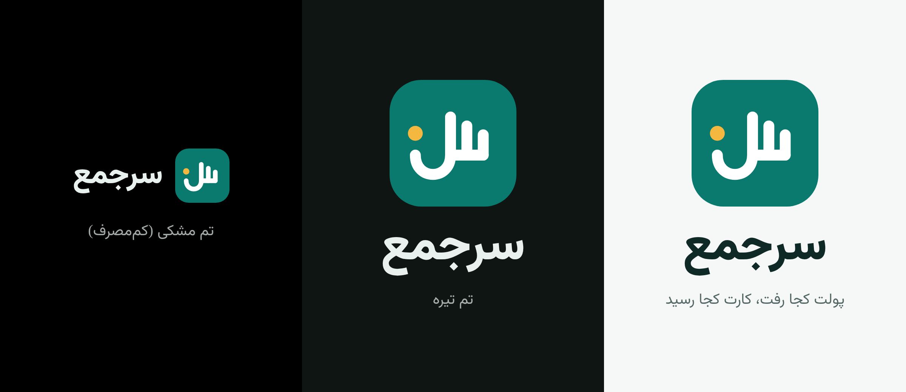

# طراحی سرجمع

شخصیت: آرام، دقیق، ایرانیِ امروزی. فیروزه‌ای رنگ اصلی (کاشی ایرانی، حس آرامش پولی)؛ زعفرانی فقط برای نتیجه و هدف.

## لوگو

سه دندانه حرف «س» = سه ستون نمودار؛ کاسه «س» = خط جمع زیر اعداد؛ سکه زعفرانی = حاصل جمع. فایل‌ها در `brand/`.

## رنگ‌ها

| نقش | روشن | تیره |
| --- | --- | --- |
| اصلی (فیروزه) | `#0B7A6E` | `#3FC1AE` |
| روی اصلی | `#FFFFFF` | `#00201C` |
| نتیجه و هدف (زعفران) | `#C98A12` | `#F4B740` |
| واریز | `#16805B` | `#5BD19C` |
| برداشت (انار) | `#C2413B` | `#F2837D` |
| پس‌زمینه | `#F6F8F7` | `#0E1513` |
| سطح | `#FFFFFF` | `#16201D` |
| متن | `#0F2A26` | `#E8F1EE` |
| متن کم‌رنگ | `#5B6E6A` | `#9FB3AE` |
| مشکی مطلق | — | پس‌زمینه `#000000`، سطح `#0B0F0E` |

واریز و برداشت همیشه علامت + و − هم دارند (برای کسی که رنگ را خوب تشخیص نمی‌دهد).

## تم‌ها

- حالت: روشن · تیره · مشکی مطلق (کم‌مصرف OLED) · پیروی از گوشی · خودکار با غروب
- رنگ اصلی: فیروزه · لاجورد `#2F5BD3` · زعفران `#C98A12` · انار `#C2413B` · یاس `#7A4FD1` · رنگ والپیپر (اندروید ۱۲+)
- آیکون تک‌رنگ اندروید ۱۳ (themed icon)

## فونت

وزیرمتن (OFL، داخل اپ، `brand/fonts/`). انتخاب‌های دیگر قابل افزودن: استعداد، شبنم، ساحل (همه OFL). اعداد هم‌عرض (tabular) در مبلغ‌ها؛ انتخاب رقم فارسی یا انگلیسی؛ اندازه متن قابل تغییر.

| سبک | اندازه / وزن |
| --- | --- |
| مبلغ بزرگ | 32 / 800 |
| عنوان صفحه | 22 / 700 |
| عنوان کارت | 16 / 700 |
| متن | 14 / 400 |
| توضیح | 12 / 400 |

## امضاهای تجربه کاربری

- مبلغ‌های بزرگ زیر عدد به حروف: «۲۰ میلیون و ۱۴ هزار تومان».
- یک‌دستی: کارهای اصلی پایین صفحه.
- به‌جای «مطمئنی؟» دکمه «برگردان» (Undo) بعد از هر کار.
- مرور بی‌دسته‌ها با کشیدن کارت‌ها (چپ = پیشنهاد درست، راست = دسته دیگر).
- جستجوی سراسری: مبلغ، اسم کارت، یادداشت، کار.
- هر صفحه خالی: یک جمله + یک دکمه شروع.
- گوشه‌ها 16، فاصله‌ها مضرب 8، سایه نه؛ مرز نازک یا تفاوت سطح.
- پشتیبانی کامل TalkBack و متن بزرگ.
